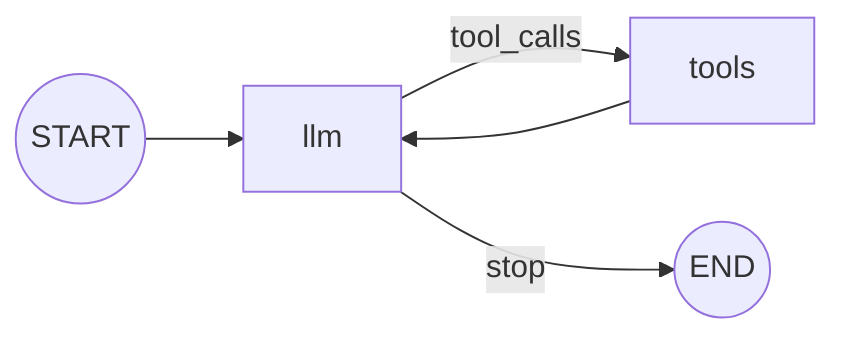

# DAG agent loop demo

A standalone demo of `agent.Graph[S]` that wires an **LLM node** and a
**ToolNode** into a LangGraph-style agent loop.

## Run

Offline mode (default, no network, no API key):

```bash
go run ./example/graph
```

Live mode against any OpenAI-compatible endpoint:

```bash
OPENAI_API_KEY=sk-... OPENAI_MODEL=gpt-4o-mini go run ./example/graph

OPENAI_BASE_URL=http://localhost:11434/v1 \
OPENAI_MODEL=qwen2.5 \
go run ./example/graph
```

Pass a prompt as arguments:

```bash
go run ./example/graph "What time is it? Use the current_time tool."
```

Live mode is used when `OPENAI_API_KEY` or `OPENAI_BASE_URL` is set. Otherwise
the demo runs a scripted client that asks for the `add` tool on the first turn
and summarizes the result on the second.

## Graph



- **`llm`** is the LLM node: it sends `state.Messages` plus
  `registry.GetToolDefinitions()` through the OpenAI-compatible client,
  appends the assistant message and marks the run done on `finish_reason=stop`.
- **`tools`** is the ToolNode: it executes every tool call in the last
  assistant message through `tools.ToolRegistry.RunTool`, which returns a
  `ToolRunResult` envelope (`{"Success":...,"Error":...,"Data":...}`). It
  appends one `role=tool` message per call so the model can react to failures;
  registry-level failures such as an unknown tool abort the run, mirroring
  `agent.Model`.
- The conditional edge routes `llm` to `tools` while tool calls are pending
  and to `END` once the model answers. `tools -> llm` closes the loop.
- `SetMaxSteps(8)` bounds the loop.

## Example output (offline)

```text
=== graph agent loop ===
backend:  scripted offline LLM
trace:    llm -> tool:add -> llm

messages:
  1. user:     What is 17 + 25? Use the add tool, then summarize the result.
  2. assistant: 
     tool_call: add({"A":17,"B":25})
  3. tool:     {"Success":true,"Error":"","Data":"42"}
  4. assistant: The add tool returned 42.

answer: The add tool returned 42.
```

## Notes

- The graph is generic over its state type: `agent.NewGraph[agentState]()`.
  Nodes receive the state by value and return the state for the next node.
- Registered tools: `add` (two integer arguments) and `current_time` (no
  arguments).
- The same pattern works with `agent.Model` for single nodes, but building the
  loop from an LLM node + ToolNode is what makes the control flow explicit.
