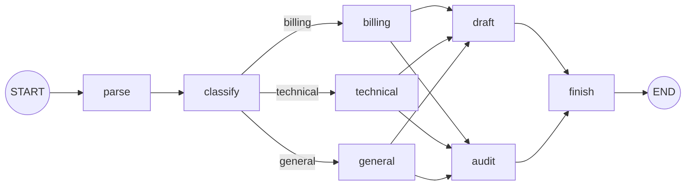

# DAG pipeline demo

A standalone, offline demo of the `agent.Graph` executor. It runs a support
ticket through a small DAG built with `AddNode`, `AddEdge`,
`AddConditionalEdge`, `SetMaxSteps` and `Compile`.

No API key or network access is required.

## Run

```bash
go run ./example/graph
```

Pass a ticket as arguments to exercise other branches:

```bash
go run ./example/graph "Urgent: the dashboard is down after the last deploy"
go run ./example/graph "How do I export my data?"
```

## Pipeline



- `classify` writes `category`, and the conditional edge routes on it.
- Every handler (`billing`, `technical`, `general`) fans out to `draft` and
  `audit`, which run in the same superstep in definition order.
- `finish` is a join: it is activated by both branches and runs once.

## Example output

```text
=== support ticket triage ===
ticket:   Urgent: I was charged twice for the October invoice.
words:    9
category: billing
priority: high
owner:    finance team
audit:    passed
reply:    Thanks for reaching out. Your ticket has been assigned to the finance team with high priority.
summary:  assigned to finance team: Thanks for reaching out. Your ticket has been assigned to the finance team with high priority.
trace:    parse -> classify -> billing -> draft -> audit -> finish
```

The final state struct is printed as JSON at the end.

## Notes

- The graph is generic over its state type: `agent.NewGraph[ticketState]()`.
  Nodes receive the state by value and return the state for the next node.
- `SetMaxSteps(8)` protects the run; this pipeline needs five supersteps
  (`parse`, `classify`, handler, `draft`+`audit`, `finish`).
- Swap a node body for `model.Invoke(...)` to turn any step into an LLM call;
  the graph does not require it.
